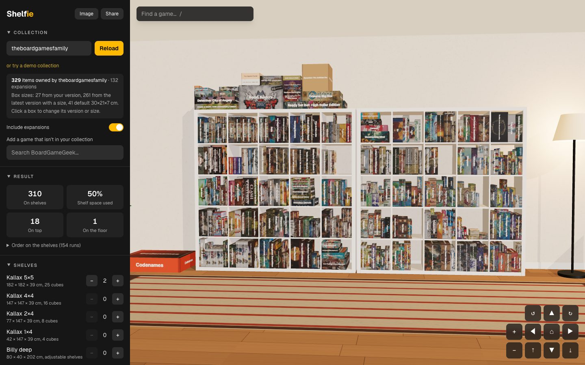
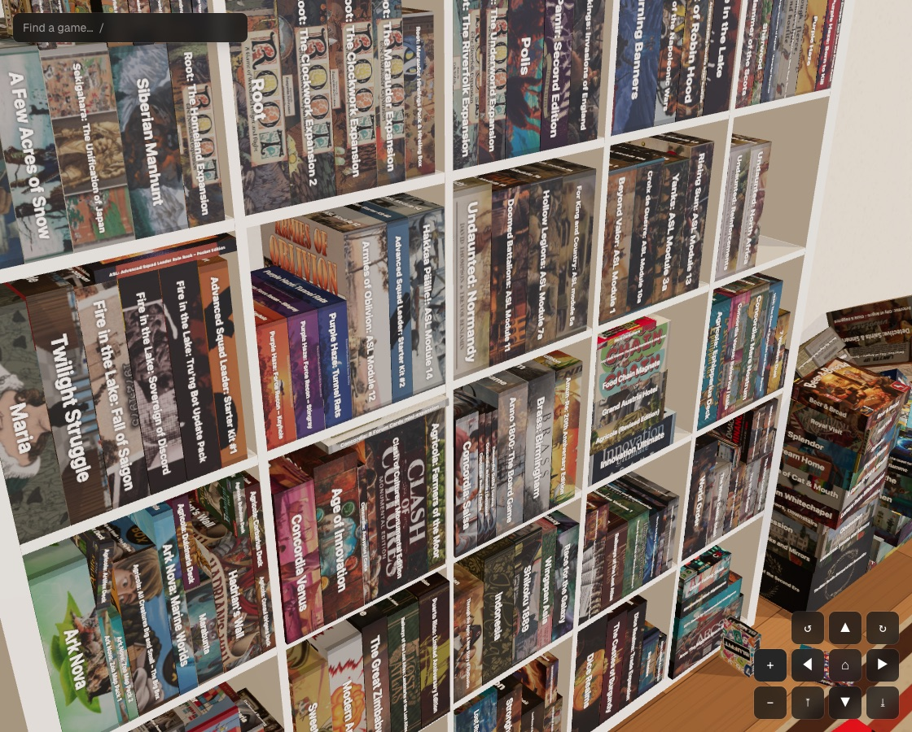
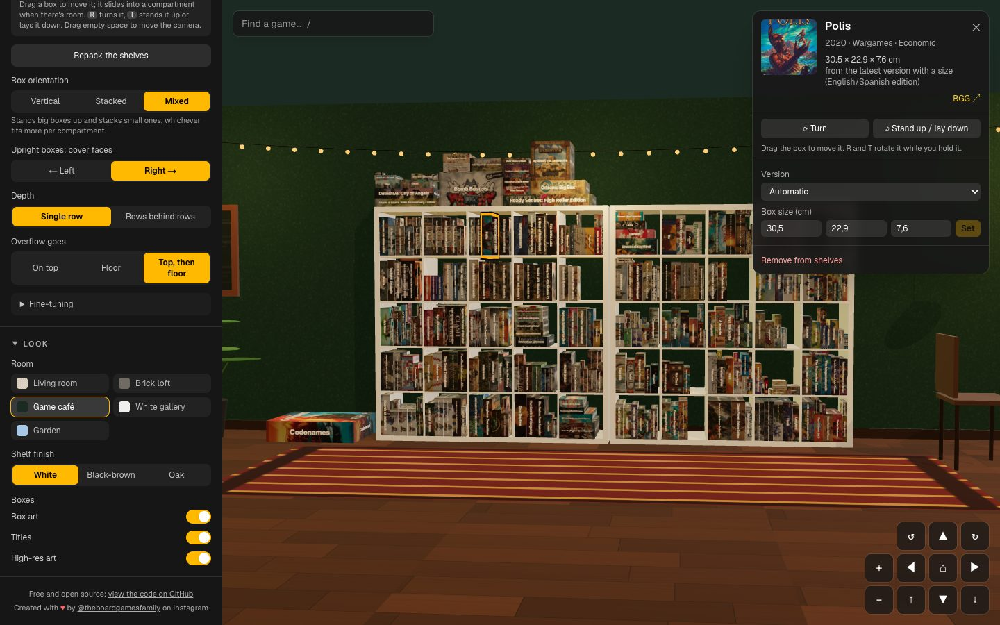
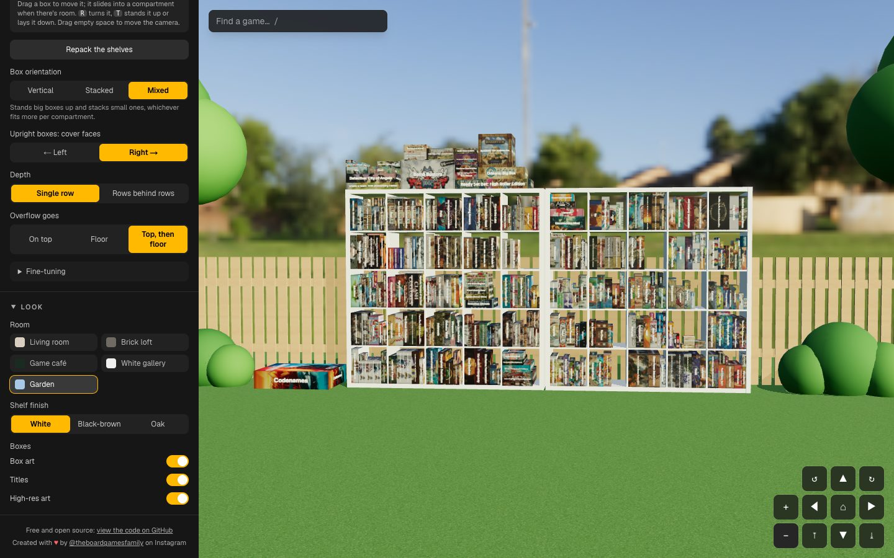

# Shelfie

**See your [BoardGameGeek](https://boardgamegeek.com) collection packed onto real shelves, in 3D.**

Enter a BGG username and Shelfie loads the games you own, works out each box's size and packs them onto IKEA Kallax and Billy shelves, or onto shelves built to your own measurements. Plan new shelves before you buy them, see how much space is left, or just enjoy your collection in a cosy room.

Shelfie is free and open source. Live at **https://shelfie.theboardgamesfamily.com** (see [Deploying to Vercel](#deploying-to-vercel) to run your own).



| Box art on every side | Game café, with a game selected |
|---|---|
|  |  |
| **Garden** | |
|  | |

## Features

The side panel follows the order you'd decide things in.

### Collection

- **Your BGG collection:** the games you own (`own=1`), with their box art. No account needed, just a username. There's a demo collection too.
- **Real box sizes:** the version you selected on BGG; otherwise the most recently released version that lists a size; otherwise 30 × 21 × 7 cm. Click any box to pick a different version or type its size.
- **Your edits:** hide games, or add games you don't own yet from a BGG search. Expansions can be left out.

### Shelves

- **IKEA models:** Kallax 5×5, 4×4, 2×4 and 1×4; Billy and Billy deep, with 4–7 compartments. Any mix and count.
- **Custom shelves:** your own outer size, columns × rows, board thickness, plinth and back panel. The compartment size updates as you type.

### Sorting

- **Areas first:** for example by BGG game type (Wargames, Strategy, Family…), optionally starting each area in a new compartment.
- **Then a second key:** theme, mechanic, designer, publisher, series, colour, box size, year, complexity, rating or name.
- **Either level can be reversed,** and expansions always follow their base game.

### Placement

- **Three modes:**
  - **Physics** (the default): Shelfie packs the shelves, then real gravity takes over. Grab, move and throw boxes.
  - **Auto:** a static, perfectly packed result.
  - **Manual:** every game starts in piles on the floor and you shelve each box yourself. Positions are saved.
- **Packing options:**
  - boxes upright, stacked flat, or mixed, with covers facing left or right;
  - rows behind rows;
  - overflow on top of the units, on the floor, or both.
- **Never squashed:** small boxes can stand or lie on bigger ones, but never the other way round.
- **Fine-tuning:**
  - space between columns;
  - left, centre or right alignment, with stacks built from that side;
  - how far boxes stick out or sit back from the front edge;
  - how many games may jump ahead in the order to fill a gap.
- **Drag and drop:**
  - a held box floats under the pointer and slides into a compartment when there's room;
  - it snaps to nearby gaps that fit;
  - <kbd>R</kbd> turns it and <kbd>T</kbd> stands it up or lays it down.

### Look and tools

- **Rooms:** five, each with its own lighting and furniture.
  - **Living room:** evening lamp.
  - **Brick loft:** factory window and pendants.
  - **Game café:** string lights.
  - **White gallery:** track spotlights.
  - **Garden:** midday sun.
- **Shelf finish:** white, black-brown or oak. Box art and titles can each be switched on or off.
- **Find a game:** search by name and the camera flies to it.
- **Camera:** drag to orbit and scroll to zoom, or use the on-screen pad, which works on phones too.
- **Image export:** the current view at 2× resolution, or the whole collection front-on (up to 4096 px).
- **Share links:** one link carries the collection, every setting, your custom shelves and your edits.

### Keyboard

| Key | Does |
|---|---|
| <kbd>/</kbd> | Jump to "Find a game" |
| <kbd>↑</kbd> <kbd>↓</kbd> <kbd>Enter</kbd> <kbd>Esc</kbd> | Move through, pick or clear search results |
| <kbd>R</kbd> / <kbd>T</kbd> | Turn the held or selected box / stand it up or lay it down (Physics and Manual) |
| <kbd>←</kbd> <kbd>→</kbd> | Change the choice in any option row, such as orientation or alignment |
| <kbd>Enter</kbd> / <kbd>Space</kbd> | Use the on-screen camera buttons |

## Accessibility

Shelfie aims for WCAG 2.1 AA, and an [axe-core](https://github.com/dequelabs/axe-core) audit reports no violations on desktop or phone layouts.

- **Labelled controls:** every control has a proper label; option rows are radio groups you can use with the arrow keys; text meets AA contrast; keyboard focus is always visible.
- **Announcements:** loading progress, errors, copied links, search results and the selected game are announced to screen readers.
- **Without a mouse:** "Find a game" selects any game, and the camera pad moves the view.
- **Reduced motion:** camera moves are instant when your system asks for less motion.

The 3D view itself can't be read by a screen reader. Each game's details card and the search box are the accessible way to explore the collection. Issues and ideas are welcome.

## Running locally

Requires Node.js 20.9+ and a BGG API token. BGG's XML API needs one: register an application at https://boardgamegeek.com/applications.

```bash
cp .env.example .env.local   # paste your token into BGG_API_KEY
npm install
npm run dev
```

The token never reaches the browser; the client only talks to the app's own `/api/*` routes. Without a token, the demo collection still works.

## Deploying to Vercel

The repo is ready for Vercel (`vercel.ts` holds the project config).

1. **Create the project:**
   - **Dashboard:** go to [vercel.com/new](https://vercel.com/new) and import `fmestevez/shelfie`;
   - **CLI:** run `npm i -g vercel@latest`, then `vercel link`.
2. **Add the BGG token** for Production and Preview:
   ```bash
   vercel env add BGG_API_KEY production
   vercel env add BGG_API_KEY preview
   ```
3. **Deploy:** push to `main` (with the Git integration) or run `vercel --prod`.
4. **Add the domain:**
   ```bash
   vercel domains add shelfie.theboardgamesfamily.com
   ```
   At your DNS provider for `theboardgamesfamily.com`, create a `CNAME` record pointing `shelfie` to `cname.vercel-dns.com`. Vercel issues the HTTPS certificate once DNS resolves. The dashboard (Project → Settings → Domains) shows the exact record it expects.

`NEXT_PUBLIC_SITE_URL` is optional. It sets the URL used in link previews and defaults to the production domain.

## How it works

**Built with:** Next.js (App Router), React, three.js via React Three Fiber and drei, Rapier physics, zustand and Tailwind CSS.

- **BGG data:** `src/lib/bgg.ts` with `src/app/api/bgg/*` fetches:
  - the collection (`own=1&version=1`, retried while BGG answers 202);
  - game details (domains, categories, mechanics, base games for expansions);
  - versions (sizes over 1 m are ignored as data-entry mistakes);
  - search results.

  These are cached with `use cache`.
- **Box art:** `src/app/api/img` proxies `cf.geekdo-images.com`, so the art can be used in WebGL and analysed for colour.
- **Order:** `src/lib/sorting.ts` builds it: areas, then groups, with expansions after their base game.
- **Packing:** `src/lib/packing.ts` fills each compartment greedily, in reading order:
  - each row is packed as a 2D free-space layout with gravity, and a box must rest at least 60% on boxes no smaller than itself;
  - several strategies are tried per compartment, and the one that fits the most wins;
  - rows are then aligned (mirrored for right alignment, centred stack by stack for centre);
  - games that don't fit go to the overflow areas.
- **Physics and manual mode:** `src/components/three/PhysicsWorld.tsx` runs both with `@react-three/rapier`, loaded only when one of them is on. Dragging uses shape casts to find where a box can slide in and to snap it to nearby gaps.
- **Rendering:** `src/components/three/` draws the scene: spines with titles over a band of box art, a colour per cover from its most prominent hue, and each room's decor and lights (`Decor.tsx`, `Room.tsx`).

## Contributing

See [CONTRIBUTING.md](CONTRIBUTING.md) and the [Code of Conduct](CODE_OF_CONDUCT.md).

## Credits

Created with ♥ by [@theboardgamesfamily](https://www.instagram.com/theboardgamesfamily/) on Instagram, built together with [Claude](https://claude.ai), Anthropic's AI.

## Licence

[GNU General Public License v3.0](LICENSE).

Board game data and images come from [BoardGameGeek](https://boardgamegeek.com) and belong to their respective owners. Shelfie isn't affiliated with BGG or IKEA; "Kallax" and "Billy" are IKEA product names, used only to describe the shelf dimensions.
